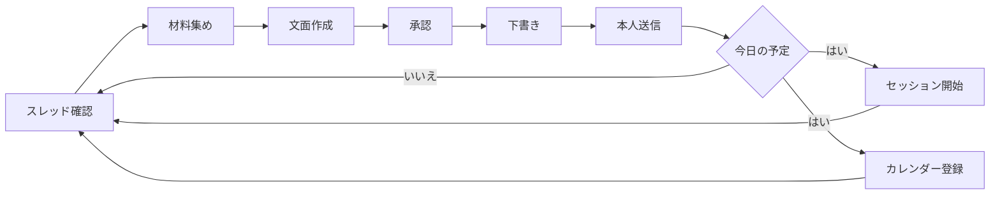

# Do³ モーニング

平日の朝、Do³ の日次セッション（ `do_daily_v2` ）で本人が送る返信を用意する。Do³ は営業日の朝、#01_1on1_prd_mktops などのチャンネルにメンバーごとのスレッドを立て、昨日終わらせたこと、今日の予定、判断に迷った場面、その判断基準を 1 問ずつ聞き、最後にまとめを示す。予実を共有し、どんな場面でどんな基準で判断しているかを積み重ねて見えるようにするのが Do³ の目的である。

このタスクは各問いへの返信を本人の言葉で書き、本人の承認を得てからスレッドに下書きとして置く。送信は本人が Slack で行い、送ったことをこのセッションに伝える。今日の予定を用意するときは、前営業日に届いた依頼のうち Issue のないものを案にし、本人が選んだものを Linear の Issue にし、候補のうち空き時間に収まる分だけを選ぶ。予定が送られたら、挙げた作業ごとに Claude Code の背景セッションを始めて取りかからせ、作業時間をカレンダーに入れる。報告はすべて日本語で書く。

## Workflow

Do³ の問い 1 つにつき、次の流れを 1 周する。本人が下書きを送ると Do³ が次の問いを投稿するため、毎回スレッドを読み直してから次の文面を書く。今日の予定が送られていれば、次の問いに移る前に、まだ済ませていない [Kickoff](#kickoff) と [Calendar](#calendar) をそれぞれ行う。



スレッドの読み書きには、チャンネルの ID と親メッセージの ts が要る。 `slack_search_public_and_private` を `do_daily_v2` と `on:<今日の日付（JST）>` 、 `include_bots: true` 、 `response_format: detailed` で検索する。Do³ はメンバーごとに `<@本人の ID> <@Do3> do_daily_v2` の形で親メッセージを立てるため、本人へのメンションを含むものを選び、その `Channel` の ID と `Message_ts` を使う。 `concise` 形式の結果には ts が出ない。スレッドがなければ、「今日の Do³ のスレッドはない」とだけ報告して終える。スレッドを読み、本人がまだ送っていない問いから返信を用意する。

本人の Slack ID は、Slack ツールが示すログイン中のユーザー ID で分かる。Slack の表示名は「（11日 午後休）」のような添え書きで日によって変わるため、本人の投稿は名前ではなく `from:<@本人の ID>` で探す。

## Questions

Do³ の問いと、それぞれへの返信の形を次に示す。材料の取り方は問いごとの節に書く。

| 問い | 返信の形 | 材料 |
| :-- | :-- | :-- |
| 昨日終わらせたこと | 挨拶と前置きの後に、番号付きの一覧 | 前営業日の Calendar・Slack・Claude のセッション・Linear・git |
| 今日の予定（優先度順） | 前置きの後に、Linear の Issue へのリンク付きの一覧 | Linear の担当 Issue、前営業日に届いた依頼、その日の Calendar |
| 判断に迷った場面 | 3 文ほどの文章 | 前営業日の Claude のセッションでの本人の発言 |
| 何を基準に判断したか | 3〜4 文の文章 | 送った場面と、同じセッションでの発言 |
| まとめの確認 | 「ありがとうございます、相違ないです。」と気づき | ここまでのスレッド |

Do³ は途中で深掘りの問いを挟むことがある。たとえば「どんな形のアウトプットになっていて誰が見れば確認できる状態までできましたか？」には、一覧にせず「いずれもスライドもしくは artifact で、チームメンバーが見て確認できる状態まで進めました。」のように 1〜2 文で答える。

## Yesterday

「昨日」は前営業日を指し、月曜なら金曜を振り返る。次の材料からその日の作業を集める。Issue になっていない作業も拾う。

| 材料 | 取り方 | 拾うもの |
| :-- | :-- | :-- |
| Google Calendar | `list_events` でその日の予定 | 会議名から、その準備にした作業 |
| Slack | `slack_search_public_and_private` を `from:<@本人の ID> on:YYYY-MM-DD` で検索し、必要ならスレッドを読む | 送付、レビュー、依頼への対応 |
| Claude のセッション | `list_sessions`（ `include_archived: true` ）と `list_events` で、その日の本人の発言を読む | 作業の中身。時刻は UTC のため JST に直して絞る |
| Linear | `list_issues` を `assignee: me` と `completedAt` 、または `creator: me` で取る | 完了した Issue、起票した Issue |
| git と GitHub | `git log` と `gh search prs --author @me` | マージした PR、追加した Skill |

一覧は、他のメンバーから見てアウトプットを確認できる粒度にまとめ、多くても 5 件ほどにする。会議そのものは項目にせず、会議の準備は項目にしてよい。各項目は `[クライアント] 内容` の形で書き、最後の項目は「各種RV」にする。

```text
おはようございます、本日もよろしくお願いします。
昨日実施した業務は以下になります。

1. [資生堂] 11/9 定例会資料の Fix と先方への送付（スライドとプランの Excel）
2. [資生堂] ラップアップ MTG の準備と、その準備手順の Skill 化
3. [資生堂] 第2回 PoC サイクル 1 初稿（クリエイティブ）の文面レビューとフィードバック
4. [FDE] FDE ダッシュボードの更新（データ連携・SFJ・資生堂 効果測定・SABON のマイルストーンの引き直しを反映）
5. 各種RV
```

## Today

今日の予定の候補は、担当の Issue と、前営業日に届いた依頼から作る。Linear の `list_issues` を `assignee: me` で、 `state` を `started` と `unstarted` にして取り、期日、優先度、マイルストーン、その日の会議に向けた準備かどうかで並べる。前営業日に届いた依頼は [Requests](#requests) のとおり Issue にする案にまとめ、Issue の候補と一緒に本人に見せる。

本人は、候補から外す Issue、Issue にする案、そのうち今日の予定に入れる案を伝える。Issue にすると選ばれた案は、文面を書く前に Issue にする。この実行で作った Issue は Triage にあり、上の `list_issues` の結果に出ないため、今日の予定に入れると選ばれたものを候補に足す。本人が挙げた作業も足し、会議そのものは入れない。そろった候補は [Slots](#slots) のとおり優先度順に今日の空き時間へ置き、置けたものだけを今日の予定にする。置けなかった候補は、空きがないため外したものとして挙げる。

各項目は Issue へのリンクにし、最後は「各種RV」にする。レビューの Issue があれば括弧内にリンクで添える。文面の承認を得るときに、[Kickoff](#kickoff) の表と [Slots](#slots) の表も一緒に示す。

```text
本日実施する予定のタスクは以下になります。

1. [MRTTOPS-9429: [資生堂] 最終報告資料の後半（今後の進め方・28 年度への言及・第2回 PoC のスライド）を直して原嶋さんに渡す](https://linear.app/active-core-swat/issue/MRTTOPS-9429)
2. [MRTTOPS-9506: [資生堂] サイクル1 初稿 → GAさま：レビュー](https://linear.app/active-core-swat/issue/MRTTOPS-9506)
3. 各種RV（[ac-llm-platform#371](https://linear.app/active-core-swat/issue/MRTTOPS-9503) ほか）
```

## Requests

前営業日に本人へ届いた依頼のうち、まだ Issue のないものを、本人が選んだ分だけ Linear の Issue にする。

### Sources

依頼の入口は議事録と Slack で、範囲は前営業日の 0 時から今日の 0 時（JST）までとする。月曜は金曜から日曜までを見る。Backlog は対象にしない。Backlog の依頼は課題として担当と期限を持ち、Linear に写すと同じ作業が 2 か所に並ぶためである。

| 入口 | 取り方 |
| :-- | :-- |
| 議事録 | `~/batb/bin/batb query --recent --limit 50` で資料データベースから取り、 `created` が範囲に入り、 `source` が Google ドキュメントのものを読む。一覧は `updated` の新しい順に並ぶので、末尾の `updated` が範囲の始まりより新しければ `--limit` を増やして取り直す。本文は `source` の URL から Google Drive の `read_file_content` で読む |
| Slack | `slack_search_public_and_private` で本人へのメンションを下の引数で検索し、 `cursor` を辿ってすべて取る。依頼かどうかにスレッドの文脈が要るときは、 `slack_read_thread` で親から読む |

```yaml
keywords: ["<@本人の ID>"]
after: "<前営業日の 0 時（JST）の Unix 時刻>"
before: "<今日の 0 時（JST）の Unix 時刻>"
natural_language_query: ""
sort: timestamp
response_format: detailed
include_context: false
```

`batb` が失敗したときはそのエラーを、読めなかった議事録や投稿があればその資料を、案の表とともに挙げる。

### Selection

案にするのは、本人がこれから手を動かして仕上げる作業のうち、作るものと終わりがあり、その場では終わらないものに限る。

| 入口 | 本人の作業と読めるもの | 読めないもの |
| :-- | :-- | :-- |
| 議事録 | 本人が担当と書かれた宿題、文字起こしで本人が引き受けた作業 | 担当が書かれていない項目、決定事項の記録 |
| Slack | 本人への依頼・確認 | cc だけの投稿、お礼や相槌、bot の定型投稿、複数人宛で本人が引き受けていない依頼 |

議事録で本人を指す名前は、Slack の検索結果で本人へのメンションに付く表示名から、添え書きを除いたものである。

本人の作業と読めても、次に当たるものは案にしない。

| 除くもの | 例 |
| :-- | :-- |
| 予定の操作 | 会議の設定、招待の送付、日程の調整 |
| その場で終わる作業 | スレッドで返せば済む回答、返事を求められていない共有への目通し、権限の付与、リンクの転送 |
| 済んでいる作業 | 本人が対応済みと返信した依頼、会議中に済ませた作業、期限が過ぎた当日中の作業 |
| PR のレビュー | 定期タスク auto-review が PR ごとに Issue を作る |
| 終わりのない作業 | 会議への出席、毎回の役割 |
| 中身を読み取れない作業 | 何をするかが議事録に書かれていない宿題 |

### Matching

すでにある Issue と重なる依頼は案にしない。照合先は、[Today](#today) で取った Issue と、 `list_issues` を `assignee: me` と `createdAt: -P14D` で取った Issue のうち、完了でも取り消しでもないものである。後者で、Triage やバックログにある Issue も拾う。照合は次の 2 つで、どちらかに当たれば案にしない。

| 照合 | 当たりとするもの |
| :-- | :-- |
| ファイル | 依頼の文面が指す Google のスライド・スプレッドシート・ドキュメントの ID が、Issue の本文にある |
| 作業 | 言い回しが違っても同じ作業を扱う Issue がある。着手中の資料作成の Issue があれば、同じ資料への手直しの依頼も当たりとする |

議事録の Google ドキュメントは出典なので、ファイルの照合には使わない。1 つの会議から別々の宿題が出るためである。同じ依頼が議事録と Slack の両方や複数の会議に出るときは、1 つの案にまとめる。一覧の本文は途中で切れたり出なかったりするので、ファイルの照合の前に、本文が全文でない Issue を `get_issue` で読む。 `list_issues` の `query` は本文の URL を拾わないため使わない。

### Proposal

案は次の表にまとめる。title は何をするかを一文で書き、project は [Creation](#creation) のとおり選んで、合うものがなければ「なし」と書く。出典にはリンク付きの出典名と依頼の要約を、補足には宛先や担当が読み取れないなど、本人が判断に要ることを書く。

```markdown
| # | title | project | 出典 | 補足 |
| --: | :-- | :-- | :-- | :-- |
| 1 | 〇〇の資料を作る | [FDE] 制作プロセス改善 | [11/13 FDE デイリー](https://docs.google.com/document/d/<doc_id>/edit)：〇〇の資料作成の宿題 | 担当の書き方が曖昧 |
```

表の後に、ファイルの照合で除いた依頼を、出典と、同じファイルが書かれた Issue の URL とともに挙げる。案が `1` 件もなければ、その旨を `1` 行で述べる。

### Creation

本人が選んだ案を、返信で直された点を反映して `save_issue` で作る。

| field | value |
| :-- | :-- |
| team | `marutto-ops` |
| project | 内容に合う進行中のプロジェクト |
| assignee | `me` |
| state | `Triage` |
| priority | `3` |

project は `list_projects({ team: "marutto-ops", state: "started" })` の一覧と、出典から読み取れるクライアント名やプロジェクト名を突き合わせて選ぶ。迷ったときは `~/batb/bin/batb term infer "<タイトルや文面>"` で用語を確かめ、合うものがなければ付けない。

description は出典の引用から始め、Issue から依頼の原文へ辿れるよう、リンクを引用の中に埋める。引用は議事録や投稿を読み直して取る。リンク先は、議事録なら `https://docs.google.com/document/d/<doc_id>/edit` 、Slack なら検索結果の permalink とする。引用だけで作業が伝わらないときは、引用の下に背景と完了の条件を数行で足す。

```markdown
> **<依頼者>** [2026-11-13 15:18](<依頼の permalink>)
>
> <依頼の原文>
```

作った Issue は、title と URL を案ごとに示す。

## Kickoff

本人が今日の予定を送ったら、改めて確認せずに、スレッドを読み直して送られた一覧の項目ごとに背景セッション（ `claude --bg` ）を始める。承認した文面と送られた文面が違えば、送られた文面に従う。セッションは Remote Control 付きで始めるので Claude Desktop のサイドバーに並び、本人はそこから開いて続きを指示する。Kickoff が書き込むのは、指示のファイル、背景セッション、その固定と解除だけで、カレンダーの予定は [Calendar](#calendar) が作る。

### Items

一覧の 1 行を 1 件とし、Slack に表示される行の文面から一覧の番号を除いたものを、その項目の名前とする。今日の予定の書式では、Issue の項目の名前は `<Issue の ID>: <タイトル>` になり、行のリンク先が Issue の URL である。レビューを作業とする項目は除く。「各種RV」や、タイトルに「レビュー」「RV」を含む項目がこれにあたる。レビューは本人が行い、PR のレビューのセッションは定期タスク auto-review が始める。

始める項目ごとに、セッションを始めるフォルダを決める。Issue の項目は `get_issue` で説明・添付・プロジェクトを読み、そこに出てくるリポジトリや PR を手がかりに、 `~/Documents` の直下、 `~/batb` 、 `~/.claude` にある Git のリポジトリから選ぶ。それぞれのリポジトリ名は `git -C <フォルダ> remote get-url origin` で分かる。どのリポジトリにも当てはまらない作業（スライドや資料づくりなど）は「このコンピューター」で始める。

```markdown
| # | 作業 | フォルダ | セッション |
| --: | :-- | :-- | :-- |
| 1 | MRTTOPS-9429: [資生堂] 最終報告資料の後半（今後の進め方・28 年度への言及・第2回 PoC のスライド）を直して原嶋さんに渡す | このコンピューター | 始める |
| 2 | MRTTOPS-9506: [資生堂] サイクル1 初稿 → GAさま：レビュー | | 除く（レビュー） |
| 3 | 各種RV（ac-llm-platform#371 ほか） | | 除く（レビュー） |
```

### Start

セッションは Skill `session-kickoff` に従って、次の順に始める。

1. `session-kickoff` の Start の 1 のとおり CLI のログインを確かめる。ログインしていなければ、セッションを始めずに止め、「CLI へのログインが必要（ `claude auth login` ）」と報告する
2. `session-kickoff` の Unpin のとおり固定を見直す。このタスクの決めた形は、名前が Issue の ID で始まるセッションである。 `get_issue` で Issue を読み、状態の種類が `completed` か `canceled` であれば固定を外す
3. `claude agents --json --all` で、 `kind` が `background` で、 `name` が Issue の ID か項目の名前を含むセッションを探す。見つかった項目は新たに始めない
4. 残りの項目ごとに、[Brief](#brief) のとおり指示のファイルをこの実行の scratchpad に書き、承認の表で示したフォルダで、項目の名前をセッションの名前として始める。Issue の項目は固定する。Issue のない項目は、固定を外す時期が決まらないので固定しない

モデルは Opus 5.5（ `claude-opus-5-5` ）、effort は `xhigh` にするため、追加の引数は `--model claude-opus-5-5 --effort xhigh` とする。別名の `opus` は Opus 5 で始まるため使わない。

「このコンピューター」は、Claude Desktop がフォルダを指定しないセッションに使う置き場である。 `~/Library/Application Support/Claude/scratch-workspaces/4e1795b5-fd40-46bf-b0ee-c2ab9e8f762b/e56be690-54d3-4900-8fac-2d99cf8625c5/` に `scratch-<YYYY-MM-DD>-<16 進 6 桁>` のフォルダを作り、 `-w` を付けずに始める。このセッションは、サイドバーで「Remote Control」の下に並ぶ。

### Brief

次をこのまま書き、 `<>` を埋める。スレッドの permalink は、検索結果の `Permalink` から `?` 以降を除いたものである。Issue のない項目は、Issue の行と手順の 3 を除き、手順の番号を詰める。

```markdown
<名前> に取り組む。このセッションは、利用者が Do³ のスレッドで今日の予定に挙げた作業として、定期タスク do3-morning が始めた。

- Do³ のスレッド：<スレッドの permalink>
- Issue：<Issue の URL>

## 手順

1. 上のリンク先と、そこから辿れる資料を読み、今日どこまで進めるかを決める。進め方や完了の条件が読み取れないときは、推測で進めずに利用者に聞く
2. 作業に関わる Skill を確かめ、それに従って進める
3. 決めたこととその理由、参照した資料、置いた仮定、利用者から聞いたことなど、作業の前提が分かったら、その都度 Issue のコメントに書く。確認は要らない。人の名前には `@` を付けず、メンションしない
4. 他の人をメンションして伝える前、Issue の説明や状態を変える前、Slack・GitHub・Notion・Google Drive など他の人が見る場所に書き込む前は、全文と書き込み先を利用者に示し、利用者がはっきり同意するまで書き込まない
5. 区切りがついたら、成果物の所在と残りの作業を利用者に報告する
```

### Report

始め終えたら、[Items](#items) の表の「セッション」の列を結果に置き換えて示す。始めた項目には `<id>` を、始めなかった項目には理由（レビュー、既存のセッションがある、CLI へのログインが必要、始められなかった）を書き、既存のセッションがある項目にはその `<id>` も添える。出力に `backgrounded` の行がなかった項目は始められなかったものとし、表の後に出力の全文と指示のファイルのパスを書く。固定できなかった項目にはそのエラーを、固定を外したセッションがあればその id と名前を、表の後に書く。作業を終えたセッションは、本人が `claude rm <id>` で消す。worktree で始めたセッションは worktree ごと消える。

## Calendar

今日の予定の項目ごとに作業時間と分類を決め、送られたらその時間を本人の Google Calendar に入れる。カレンダーに書き込むのは、この予定の作成だけである。

### Slots

空き時間は、今日の 9:30〜18:30 のうち、予定で埋まっていない時間とする。予定は Google Calendar の `list_events` で今日の分を取る。このとき、 `transparency` が `transparent` の予定（カレンダーで「予定なし」と表示する枠。本人の [雑務]・[タスク管理]・バッファなど）と、本人の返事（ `attendees` のうち `self` が真のものの `responseStatus` ）が `declined` の予定は、埋まっている時間に数えない。返事をしていない招待（ `needsAction` ）と不在（ `eventType` が `OUT_OF_OFFICE` ）は数える。空きは、文面を用意している時刻を 15 分単位に切り上げた時刻から数える。

カレンダーの予定は、項目 1 件ごとと、「各種RV」に添えたレビューの Issue 1 件ごとに 1 つ置き、「各種RV」の行そのものには置かない。長さは、レビューの項目（[Items](#items) と同じ判定）と「各種RV」に添えたレビューの Issue が 15 分、それ以外が 1 時間である。

各予定は優先度順に、その長さだけ続く空きのうち最も早いところへ 15 分単位で置き、分けては置かない。

文面の承認を得るときに、置いた時間を予定 1 件につき 1 行の表で示す。分類は [Colors](#colors) の基準で決める。本人はこの場で時間や分類を直せる。

```markdown
| 作業時間 | 予定 | 分類 |
| :-- | :-- | :-- |
| 9:45〜10:45 | MRTTOPS-9429: [資生堂] 最終報告資料の後半（今後の進め方・28 年度への言及・第2回 PoC のスライド）を直して原嶋さんに渡す | プロジェクト推進系 |
| 10:45〜11:00 | MRTTOPS-9506: [資生堂] サイクル1 初稿 → GAさま：レビュー | その他 |
```

### Colors

予定の色は分類で決め、 `create_event` の `colorId` で指定する。

| 分類 | 色 | colorId | 当てはまる作業 |
| :-- | :-- | :-- | :-- |
| プロジェクト推進系 | フラミンゴ | `4` | クライアントの案件や FDE のプロジェクトを進める作業（資料・実装・制作） |
| チームマネジメント系 | ラベンダー | `1` | 定例の準備、1on1、メンバーの育成、チームの運用ルールやダッシュボード |
| その他 | セージ | `2` | レビュー、社内の雑務、自分の仕組みの改善 |

### Events

本人が今日の予定を送ったら、改めて確認せずに、送られた一覧の項目をカレンダーに入れる。背景セッションを始められたかどうかは問わない。作業時間と分類は、承認の場で示したもの（本人がそこで直したものを含む）を、送られた一覧の同じ項目にそのまま使う。

作る前に今日のカレンダーを読み直し、次の項目だけを [Slots](#slots) のとおりその場で置き直す。残りの項目は承認した時間のままとし、その時間は埋まっている時間に数える。

- 承認した時間が、読み直したカレンダーで埋まっている項目
- 承認の場になく、送られた文面にだけある項目。分類も [Colors](#colors) の基準でその場で決める

同じ日に同じ予定がすでにある項目は作らない。summary が同じ予定のほか、Issue の項目では summary が `<Issue の ID>:` で始まる予定を同じものとする。

`create_event` で 1 件ずつ作る。招待する人は付けず、 `calendarId` と `timeZone` は渡さない。どちらも省くと、本人の主カレンダーに本人のタイムゾーンで作られる。

| field | value |
| :-- | :-- |
| summary | 項目の名前（[Items](#items) と同じ。Issue の項目では `<Issue の ID>: <タイトル>` になる） |
| startTime・endTime | 作業時間（UTC オフセットを付けない ISO 8601） |
| colorId | 分類の colorId |
| description | Issue の URL。Issue のない項目には付けない |

「各種RV」に添えたレビューの Issue の summary は、 `get_issue` で読んだ `<Issue の ID>: <タイトル>` とする。

作り終えたら、作った予定（作業時間・summary・分類）と、作らなかった項目とその理由（同じ予定がある、空きがない、作れなかった）を表で示す。

## Judgment

場面は、本人がチームでの役割（FDE チームのリーダーなど）として、チームや会社のミッションに向けて下した判断から選ぶ。文言の直し方のような個別作業の迷いは、抽象度が低いため採らない。材料は前営業日の Claude のセッションでの本人の発言である。セッションが多いときはサブエージェントに読ませ、セッションごとに本人の判断を、発言の短い引用、決めたこと、その理由の 3 点で抜き出させる。

候補は 5 つ用意し、そのまま送れる文面で示して本人に選んでもらう。1 つに決め打ちしない。文面は、1 文目で迷った論点を抽象的に述べ、2 文目で具体的な場面を 1〜2 件挙げ、3 文目でミッションと懸念のどこで板挟みになったかを書く。

判断基準を書く前にスレッドを読み直し、本人が実際に送った場面を確かめる。用意した候補とは別の場面が送られていることがあるため、基準は送られた場面に合わせる。基準の文面は、1 文目で基準を「」でくくって示し、続けてそれぞれの場面への当てはめを書き、最後に一般化した使い分けと、それをチームでどう使うかを書く。

これまでに送られた場面と基準を次に示す。抽象度はこの 2 件にそろえる。

| 日付 | 場面の論点 | 判断基準 |
| :-- | :-- | :-- |
| 2026-10-30 | 制作回数を変えずに、関係者の観点を入れながら進行できるスケジュールの組み方 | PoC の目的である制作品質のベースラインに達すること。Delivery より最低限の Quality を優先する |
| 2026-11-10 | 業務を AI に任せる範囲をどこまで広げるか | 間違えたときに取り返しがつくか、影響が社外や顧客に及ぶか |

2026-11-10 に送られた場面と基準の全文を次に示す。

```text
昨日は、FDE チームとして業務を AI に任せる範囲をどこまで広げるか、その線引きに迷いました。
資生堂さまの定例準備では、自分で直した議事録を見本にして、Notion への作成まで確認なしで Claude が作り切る Skill にしました。一方で、監視の一次調査や、顧客の Lstep アカウントを画面中継で人に渡す機能のレビューでは、AI や仕組みに任せきってよいかで手が止まりました。
チームのミッションとしては業務を AI に置き換えて人に依存しない形にしたい一方、任せすぎると品質や顧客の資産を損なうおそれがある、という点が迷いどころでした。
```

```text
「間違えたときに取り返しがつくか、影響が社外や顧客に及ぶか」を基準に線を引きました。
社内の議事録のように後から直せて影響が社内に閉じるものは、見本で品質の基準を示したうえで確認なしで任せ、速さを取りました。本番や共有先への書き込み、顧客のアカウントに誰が触れられるかに関わるものは、書き込みの前に人の確認を残し、仕組みを理解するまで判断を保留しました。
可逆で社内に閉じる作業は AI に任せて自分の判断を仕組みに移し、不可逆で社外に及ぶ作業は人が責任を持つ、という使い分けです。この線引きをチームの共通の基準として言語化していきたいと考えています。
```

## Summary

Do³ はここまでの内容をまとめて「このまとめ内容で合っていますか？」と聞く。返信は「ありがとうございます、相違ないです。」に、書きながら気づいたことを 1〜3 文で添える。気づきには、その日の判断が過去の判断や本人が重視する枠組み（QCD など）とどうつながるか、チームにどう広げるかを書く。「はい、合っています」だけの返信にはしない。Do³ は返信を待たずに、上長宛ての最終のまとめを投稿することがある。まとめの確認が届いたら、すぐに文面を用意する。

```text
ありがとうございます、相違ないです。
本日記載した判断は、一見するとどのような軸で判断したか自分の中で整理できていませんでしたが、書きながら自身の中で重視しているQCDのフレームワークに落とし込めることに気がつきました。
```

## Posting

Do³ のチャンネルは社外と共有しているチャンネル（Slack Connect）のため、 `slack_send_message` は `mcp_externally_shared_channel_restricted` で失敗する。返信は `slack_send_message_draft` で下書きにし、送信は本人に任せる。

| 手順 | 操作 |
| :-- | :-- |
| 1 | 文面の全文をコードブロックで見せ、承認を得る |
| 2 | `slack_send_message_draft` に、親メッセージの ts を `thread_ts` として渡して下書きを置く |
| 3 | 本人が送信したら `slack_read_thread` で、送られた文面と Do³ の次の問いを読む |

Linear のリンクは `[MRTTOPS-xxxx: タイトル](URL)` の Markdown で書く。送信すると Slack のリンクになる。送信されていない下書きが残っていると、 `draft_already_exists` で失敗することがある。そのときは古い下書きの送信か削除を本人に頼む。

## Style

文面は、本人が手を入れずに送れる日本語で書く。本人の過去の返信を `in:<#チャンネル> from:<@本人の ID>` で読み、言い回しをそろえる。です・ます調にし、挨拶は最初の返信にだけ付ける。一覧の返信には、上の例と同じ 1 行の前置きを付ける。場面、基準、気づきの文章は Skill `humanizer` で見直し、強調のためだけの対比、言い直しの締めの一文、ダッシュを除く。
