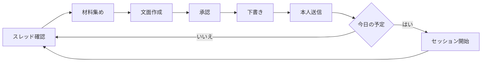

# Do³ モーニング

平日の朝、Do³ の日次セッション（ `do_daily_v2` ）で本人が送る返信を用意する。Do³ は営業日の朝、#01_1on1_prd_mktops などのチャンネルにメンバーごとのスレッドを立て、昨日終わらせたこと、今日の予定、判断に迷った場面、その判断基準を 1 問ずつ聞き、最後にまとめを示す。予実を共有し、どんな場面でどんな基準で判断しているかを積み重ねて見えるようにするのが Do³ の目的である。

このタスクは各問いへの返信を本人の言葉で書き、本人の承認を得てからスレッドに下書きとして置く。送信は本人が Slack で行い、送ったことをこのセッションに伝える。今日の予定が送られたら、挙げた作業ごとに Claude Code の背景セッションを始めて取りかからせる。報告はすべて日本語で書く。

## Workflow

Do³ の問い 1 つにつき、次の流れを 1 周する。本人が下書きを送ると Do³ が次の問いを投稿するため、毎回スレッドを読み直してから次の文面を書く。今日の予定が送られていて、まだセッションを始めていなければ、次の問いに移る前に [Kickoff](#kickoff) のとおり始める。



スレッドの読み書きには、チャンネルの ID と親メッセージの ts が要る。 `slack_search_public_and_private` を `do_daily_v2` と `on:<今日の日付（JST）>` 、 `include_bots: true` 、 `response_format: detailed` で検索する。Do³ はメンバーごとに `<@本人の ID> <@Do3> do_daily_v2` の形で親メッセージを立てるため、本人へのメンションを含むものを選び、その `Channel` の ID と `Message_ts` を使う。 `concise` 形式の結果には ts が出ない。スレッドがなければ、「今日の Do³ のスレッドはない」とだけ報告して終える。スレッドを読み、本人がまだ送っていない問いから返信を用意する。

本人の Slack ID は、Slack ツールが示すログイン中のユーザー ID で分かる。Slack の表示名は「（11日 午後休）」のような添え書きで日によって変わるため、本人の投稿は名前ではなく `from:<@本人の ID>` で探す。

## Questions

Do³ の問いと、それぞれへの返信の形を次に示す。材料の取り方は問いごとの節に書く。

| 問い | 返信の形 | 材料 |
| :-- | :-- | :-- |
| 昨日終わらせたこと | 挨拶と前置きの後に、番号付きの一覧 | 前営業日の Calendar・Slack・Claude のセッション・Linear・git |
| 今日の予定（優先度順） | 前置きの後に、Linear の Issue へのリンク付きの一覧 | Linear の担当 Issue とその日の Calendar |
| 判断に迷った場面 | 3 文ほどの文章 | 前営業日の Claude のセッションでの本人の発言 |
| 何を基準に判断したか | 3〜4 文の文章 | 送った場面と、同じセッションでの発言 |
| まとめの確認 | 「ありがとうございます、相違ないです。」と気づき | ここまでのスレッド |

Do³ は途中で深掘りの問いを挟むことがある。たとえば「どんな形のアウトプットになっていて誰が見れば確認できる状態までできましたか？」には、一覧にせず「いずれもスライドもしくは artifact で、チームメンバーが見て確認できる状態まで進めました。」のように 1〜2 文で答える。

## Yesterday

「昨日」は前営業日を指し、月曜なら金曜を振り返る。次の材料からその日の作業を集める。Issue になっていない作業も拾う。

| 材料 | 取り方 | 拾うもの |
| :-- | :-- | :-- |
| Google Calendar | `list_events` でその日の予定 | 会議名から、その準備にした作業 |
| Slack | `slack_search_public_and_private` を `from:<@本人の ID> on:YYYY-MM-DD` で検索し、必要ならスレッドを読む | 送付、レビュー、依頼への対応 |
| Claude のセッション | `list_sessions`（ `include_archived: true` ）と `list_events` で、その日の本人の発言を読む | 作業の中身。時刻は UTC のため JST に直して絞る |
| Linear | `list_issues` を `assignee: me` と `completedAt` 、または `creator: me` で取る | 完了した Issue、起票した Issue |
| git と GitHub | `git log` と `gh search prs --author @me` | マージした PR、追加した Skill |

一覧は、他のメンバーから見てアウトプットを確認できる粒度にまとめ、多くても 5 件ほどにする。会議そのものは項目にせず、会議の準備は項目にしてよい。各項目は `[クライアント] 内容` の形で書き、最後の項目は「各種RV」にする。

```text
おはようございます、本日もよろしくお願いします。
昨日実施した業務は以下になります。

1. [資生堂] 11/9 定例会資料の Fix と先方への送付（スライドとプランの Excel）
2. [資生堂] ラップアップ MTG の準備と、その準備手順の Skill 化
3. [資生堂] 第2回 PoC サイクル 1 初稿（クリエイティブ）の文面レビューとフィードバック
4. [FDE] FDE ダッシュボードの更新（データ連携・SFJ・資生堂 効果測定・SABON のマイルストーンの引き直しを反映）
5. 各種RV
```

## Today

Linear の `list_issues` を `assignee: me` で、 `state` を `started` と `unstarted` にして取る。期日、優先度、マイルストーン、その日の会議に向けた準備かどうかで並べ、まず候補として本人に見せる。本人が外した Issue は除き、挙げた作業は足す。会議そのものは入れない。

各項目は Issue へのリンクにし、最後は「各種RV」にする。レビューの Issue があれば括弧内にリンクで添える。文面の承認を得るときに、[Kickoff](#kickoff) の表も一緒に示す。

```text
本日実施する予定のタスクは以下になります。

1. [MRTTOPS-9429: [資生堂] 最終報告資料の後半（今後の進め方・28 年度への言及・第2回 PoC のスライド）を直して原嶋さんに渡す](https://linear.app/active-core-swat/issue/MRTTOPS-9429)
2. [MRTTOPS-9506: [資生堂] サイクル1 初稿 → GAさま：レビュー](https://linear.app/active-core-swat/issue/MRTTOPS-9506)
3. 各種RV（[ac-llm-platform#371](https://linear.app/active-core-swat/issue/MRTTOPS-9503) ほか）
```

## Kickoff

本人が今日の予定を送ったら、改めて確認せずに、スレッドを読み直して送られた一覧の項目ごとに背景セッション（ `claude --bg` ）を始める。承認した文面と送られた文面が違えば、送られた文面に従う。セッションは Remote Control 付きで始めるので Claude Desktop のサイドバーに並び、本人はそこから開いて続きを指示する。Kickoff が作るのは、指示のファイルと背景セッションだけである。

### Items

一覧の 1 行を 1 件とし、Slack に表示される行の文面から一覧の番号を除いたものを、その項目の名前とする。今日の予定の書式では、Issue の項目の名前は `<Issue の ID>: <タイトル>` になり、行のリンク先が Issue の URL である。レビューを作業とする項目は除く。「各種RV」や、タイトルに「レビュー」「RV」を含む項目がこれにあたる。レビューは本人が行い、PR のレビューのセッションは定期タスク potts が始める。

始める項目ごとに、セッションを始めるフォルダを決める。Issue の項目は `get_issue` で説明・添付・プロジェクトを読み、そこに出てくるリポジトリや PR を手がかりに、 `~/Documents` の直下、 `~/batb` 、 `~/.claude` にある Git のリポジトリから選ぶ。それぞれのリポジトリ名は `git -C <フォルダ> remote get-url origin` で分かる。どのリポジトリにも当てはまらない作業（スライドや資料づくりなど）は「このコンピューター」で始める。

```markdown
| # | 作業 | フォルダ | セッション |
| --: | :-- | :-- | :-- |
| 1 | MRTTOPS-9429: [資生堂] 最終報告資料の後半（今後の進め方・28 年度への言及・第2回 PoC のスライド）を直して原嶋さんに渡す | このコンピューター | 始める |
| 2 | MRTTOPS-9506: [資生堂] サイクル1 初稿 → GAさま：レビュー | | 除く（レビュー） |
| 3 | 各種RV（ac-llm-platform#371 ほか） | | 除く（レビュー） |
```

### Start

セッションは次の順に始める。

1. `claude auth status` で CLI のログインを確かめる。ログインしていなくても `claude --bg` はセッションを作り、動かないまま待たせるため、先に確かめる。 `loggedIn` が `true` でなければ、セッションを始めずに止め、「CLI へのログインが必要（ `claude auth login` ）」と報告する
2. `claude agents --json` で、 `kind` が `background` で、 `name` が Issue の ID か項目の名前を含むセッションを、状態を問わず探す。見つかった項目は新たに始めない
3. 残りの項目ごとに、[Brief](#brief) のとおり指示のファイルをこの実行の scratchpad に書き、承認の表で示したフォルダで次のコマンドを実行する

`--remote-control` で、Claude Desktop のサイドバー、claude.ai/code、スマホから開けるようにする。Git のリポジトリでは `-w` で名前を自動で付けた worktree を作り、本体のブランチや変更に触れないようにする。

「このコンピューター」は、Claude Desktop がフォルダを指定しないセッションに使う置き場である。 `~/Library/Application Support/Claude/scratch-workspaces/4e1795b5-fd40-46bf-b0ee-c2ab9e8f762b/e56be690-54d3-4900-8fac-2d99cf8625c5/` に `scratch-<YYYY-MM-DD>-<16 進 6 桁>` のフォルダを作り、 `-w` を付けずに始める。このセッションは、サイドバーで「Remote Control」の下に並ぶ。

```bash
cd "<フォルダ>" && claude --bg --remote-control "<名前>" -w -n "<名前>" --permission-mode auto "$(cat <指示のファイル>)"
```

出力の `backgrounded · <id> · <名前>` の `<id>` が、セッションを開いたり消したりするときの値である。

### Brief

次をこのまま書き、 `<>` を埋める。スレッドの permalink は、検索結果の `Permalink` から `?` 以降を除いたものである。Issue のない項目は、Issue の行を除く。

```markdown
<名前> に取り組む。このセッションは、利用者が Do³ のスレッドで今日の予定に挙げた作業として、定期タスク do3-morning が始めた。

- Do³ のスレッド：<スレッドの permalink>
- Issue：<Issue の URL>

## 手順

1. 上のリンク先と、そこから辿れる資料を読み、今日どこまで進めるかを決める。進め方や完了の条件が読み取れないときは、推測で進めずに利用者に聞く
2. 作業に関わる Skill を確かめ、それに従って進める
3. Slack・Linear・GitHub・Notion・Google Drive など他の人が見る場所に書き込む前と、Issue の状態を変える前に、全文と書き込み先を利用者に示す。利用者がはっきり同意するまで書き込まない
4. 区切りがついたら、成果物の所在と残りの作業を利用者に報告する
```

### Report

始め終えたら、[Items](#items) の表の「セッション」の列を結果に置き換えて示す。始めた項目には `<id>` を、始めなかった項目には理由（レビュー、既存のセッションがある、CLI へのログインが必要、始められなかった）を書き、既存のセッションがある項目にはその `<id>` も添える。出力に `backgrounded` の行がなかった項目は始められなかったものとし、表の後に出力の全文と指示のファイルのパスを書く。作業を終えたセッションは、本人が `claude rm <id>` で消す。worktree で始めたセッションは worktree ごと消える。

## Judgment

場面は、本人がチームでの役割（FDE チームのリーダーなど）として、チームや会社のミッションに向けて下した判断から選ぶ。文言の直し方のような個別作業の迷いは、抽象度が低いため採らない。材料は前営業日の Claude のセッションでの本人の発言である。セッションが多いときはサブエージェントに読ませ、セッションごとに本人の判断を、発言の短い引用、決めたこと、その理由の 3 点で抜き出させる。

候補は 5 つ用意し、そのまま送れる文面で示して本人に選んでもらう。1 つに決め打ちしない。文面は、1 文目で迷った論点を抽象的に述べ、2 文目で具体的な場面を 1〜2 件挙げ、3 文目でミッションと懸念のどこで板挟みになったかを書く。

判断基準を書く前にスレッドを読み直し、本人が実際に送った場面を確かめる。用意した候補とは別の場面が送られていることがあるため、基準は送られた場面に合わせる。基準の文面は、1 文目で基準を「」でくくって示し、続けてそれぞれの場面への当てはめを書き、最後に一般化した使い分けと、それをチームでどう使うかを書く。

これまでに送られた場面と基準を次に示す。抽象度はこの 2 件にそろえる。

| 日付 | 場面の論点 | 判断基準 |
| :-- | :-- | :-- |
| 2026-10-30 | 制作回数を変えずに、関係者の観点を入れながら進行できるスケジュールの組み方 | PoC の目的である制作品質のベースラインに達すること。Delivery より最低限の Quality を優先する |
| 2026-11-10 | 業務を AI に任せる範囲をどこまで広げるか | 間違えたときに取り返しがつくか、影響が社外や顧客に及ぶか |

2026-11-10 に送られた場面と基準の全文を次に示す。

```text
昨日は、FDE チームとして業務を AI に任せる範囲をどこまで広げるか、その線引きに迷いました。
資生堂さまの定例準備では、自分で直した議事録を見本にして、Notion への作成まで確認なしで Claude が作り切る Skill にしました。一方で、監視の一次調査や、顧客の Lstep アカウントを画面中継で人に渡す機能のレビューでは、AI や仕組みに任せきってよいかで手が止まりました。
チームのミッションとしては業務を AI に置き換えて人に依存しない形にしたい一方、任せすぎると品質や顧客の資産を損なうおそれがある、という点が迷いどころでした。
```

```text
「間違えたときに取り返しがつくか、影響が社外や顧客に及ぶか」を基準に線を引きました。
社内の議事録のように後から直せて影響が社内に閉じるものは、見本で品質の基準を示したうえで確認なしで任せ、速さを取りました。本番や共有先への書き込み、顧客のアカウントに誰が触れられるかに関わるものは、書き込みの前に人の確認を残し、仕組みを理解するまで判断を保留しました。
可逆で社内に閉じる作業は AI に任せて自分の判断を仕組みに移し、不可逆で社外に及ぶ作業は人が責任を持つ、という使い分けです。この線引きをチームの共通の基準として言語化していきたいと考えています。
```

## Summary

Do³ はここまでの内容をまとめて「このまとめ内容で合っていますか？」と聞く。返信は「ありがとうございます、相違ないです。」に、書きながら気づいたことを 1〜3 文で添える。気づきには、その日の判断が過去の判断や本人が重視する枠組み（QCD など）とどうつながるか、チームにどう広げるかを書く。「はい、合っています」だけの返信にはしない。Do³ は返信を待たずに、上長宛ての最終のまとめを投稿することがある。まとめの確認が届いたら、すぐに文面を用意する。

```text
ありがとうございます、相違ないです。
本日記載した判断は、一見するとどのような軸で判断したか自分の中で整理できていませんでしたが、書きながら自身の中で重視しているQCDのフレームワークに落とし込めることに気がつきました。
```

## Posting

Do³ のチャンネルは社外と共有しているチャンネル（Slack Connect）のため、 `slack_send_message` は `mcp_externally_shared_channel_restricted` で失敗する。返信は `slack_send_message_draft` で下書きにし、送信は本人に任せる。

| 手順 | 操作 |
| :-- | :-- |
| 1 | 文面の全文をコードブロックで見せ、承認を得る |
| 2 | `slack_send_message_draft` に、親メッセージの ts を `thread_ts` として渡して下書きを置く |
| 3 | 本人が送信したら `slack_read_thread` で、送られた文面と Do³ の次の問いを読む |

Linear のリンクは `[MRTTOPS-xxxx: タイトル](URL)` の Markdown で書く。送信すると Slack のリンクになる。送信されていない下書きが残っていると、 `draft_already_exists` で失敗することがある。そのときは古い下書きの送信か削除を本人に頼む。

## Style

文面は、本人が手を入れずに送れる日本語で書く。本人の過去の返信を `in:<#チャンネル> from:<@本人の ID>` で読み、言い回しをそろえる。です・ます調にし、挨拶は最初の返信にだけ付ける。一覧の返信には、上の例と同じ 1 行の前置きを付ける。場面、基準、気づきの文章は Skill `humanizer` で見直し、強調のためだけの対比、言い直しの締めの一文、ダッシュを除く。
