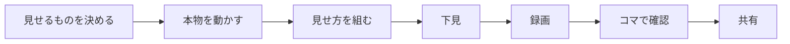

# Demo Video

動作確認やブラウザ操作を、章立てと注釈のついた動画に残す。見る人が、差分や説明文から挙動を想像せずに済むようにするためのものである。

録画は証拠であって演出ではない。何を見せ、どの値をもって良しとするかを先に決め、その値を画面に出す。画面に出すものはすべて実際の実行結果から取り、作り話を混ぜない。



## 見せるものを決める

依頼の背後にある問いを 1 文にする。「この PR は何をするのか」「この操作手順で迷わないか」「このエージェントは人に何を返すのか」のように、見る人が動画を見終えたときに答えられるべき問いである。

| 決めること | 例 |
| :-- | :-- |
| 見る人 | PR のレビュアー、依頼主、手順を覚える担当者 |
| 見せる面 | 入力、経過と待ち時間、通知の文面、保存先、成果物、人の判断材料 |
| 実測値 | 所要時間、合否、件数、画面上の値（`getComputedStyle` の結果など） |
| 条件 | PR の動作確認と同じ入力、ローカル実行、外部への送信は差し替え |

変更の確認なら、変更前と変更後、または既存データと新しいデータを並べる。片方だけでは差が分からない。

## 本物を動かす

ローカルで動かす。共有環境は他の人が使っており、やり直しの多い確認には向かない。

外へ影響が出る先（Drive への書き込み、Slack やメールの送信、決済）だけをメモリ上の偽物に差し替え、それ以外（LLM、外部 API の読み取り、リンク確認、撮影）は本物を使う。差し替えた先に渡った内容は捨てずに残し、あとで画面に出す。

処理の各段の開始と完了は、起動からの経過秒つきで `[{ t: 2.6, msg: "表記ルールの読み込み 完了" }, ...]` の形に記録しておく。対象を直接呼ぶ実行用スクリプトなら、各段の関数を包んで前後に記録を足す。別プロセスとして起動するなら、標準出力の各行に受け取った時刻を付ける。待ち時間をそのまま見せる材料になる。

起動は一度で通らないものとして扱う。最初のエラーだけを読み、足りないものを 1 つ足して再実行する。よく足りないのは、認証情報、環境変数、ブラウザの実行ファイル（`npx playwright install chromium`）である。認証情報の中身は読まず、どこから取るかを利用者に確かめる（SSO のログインなど、利用者にしかできない操作は依頼する）。

## 見せ方を組む

| 対象 | 見せ方 |
| :-- | :-- |
| 画面がある（Web アプリ） | シナリオで実際の画面を操作する。要素は役割と名前で指定する（`getByRole("button", { name: "保存" })`）。参照 ID や座標は再描画で変わる |
| 画面がない（API・ワークフロー・バッチ・エージェント） | 実行結果を [assets/scenes.html](assets/scenes.html) に流し込み、人が触れる面を 1 面ずつ見せる |

画面がない対象は、利用者が実際に触れるものの順に面を並べる。起動の仕方と入力、経過、通知の文面、保存先の構成、成果物、判断に使う情報（変更前と変更後など）、最後に人がやること、という順が基本になる。

`scenes.html` は scratchpad の作業ディレクトリへコピーし、同じ場所に実行結果から `data.js`（`window.DATA = {...}`）を書き出して使う。入れる値はファイル先頭のコメントにある。用意している面は表紙・入力・経過・通知・結果・成果物の 6 面で、変更前後の表など対象ごとの面は `<section class="scene">` を足すだけで並びに加わる。成果物の画像は [scripts/shot.mjs](scripts/shot.mjs) で幅 560px に撮る（`--size 560x800 --full`）。

| 関数 | 働き |
| :-- | :-- |
| `show(n)` | 並び順で n 番目（0 始まり）の面に切り替える |
| `await playTimeline(ms)` | 記録した経過を ms ミリ秒かけて流し、流し終えると解決する。時計は実時間の秒数を示すので、待ち時間がそのまま伝わる |
| `await scrollShot()` | 成果物の面を表示してから呼ぶ。縦に長い画像を枠の中で上から下へ 9 秒かけて送り、送り終えると解決する |

```js
// scenario.mjs（画面がない対象）
export default async ({ page, chapter, note, wait }) => {
  await page.goto(`file://${import.meta.dirname}/scenes.html`);
  await wait(4000);
  const scene = (n) => page.evaluate((x) => show(x), n);
  await chapter("1. 入力", "この JSON を渡して起動する"); await scene(1); await wait(5000);
  await chapter("2. 経過", "各段の開始と完了"); await scene(2);
  await page.evaluate(() => playTimeline(12000));
  await note("実時間 225 秒。この間、呼び出し元には応答が返らない");
  await chapter("3. 通知", "Slack に届く文面"); await scene(3); await wait(7000);
  await chapter("4. 成果物", "作られた HTML"); await scene(5);
  await page.evaluate(() => scrollShot()); await wait(1500);
};
```

## 下見

録画と同じ大きさ（既定 1280×720）で各面を [scripts/shot.mjs](scripts/shot.mjs) で撮り、はみ出しや切れがないかを見る（`node shot.mjs scenes.html s2.png --eval "show(2)"`）。画面を操作するシナリオなら、同じ操作を一度なぞって、待つべき箇所と時間を控える。下見をせずに録ると、失敗や待ちのずれがそのまま動画に残る。

## 録画

録画には Playwright を使う。対象プロジェクトに `playwright` があればそれを、無ければこの Skill 専用の置き場（`~/.cache/demo-video`）のものを使う。どちらにも無いときは、対象プロジェクトの `package.json` を変えないよう、専用の置き場に一度だけ入れる。

```shell
npm i --prefix ~/.cache/demo-video playwright && ~/.cache/demo-video/node_modules/.bin/playwright install chromium
```

[scripts/record.mjs](scripts/record.mjs) にシナリオを渡す。シナリオは `async ({ page, context, chapter, note, wait }) => {}` を default export する ES モジュールで、戻り値（実測値）は JSON で出力される。

```js
// scenario.mjs
export default async ({ page, chapter, note, wait }) => {
  await page.goto("http://localhost:3000/settings");
  await chapter("1. 設定画面", "通知の既定値を確かめる");
  const size = await page.evaluate(() => getComputedStyle(document.querySelector("footer small")).fontSize);
  await note(`フッター注釈の文字サイズ: ${size}（期待値 15px）`);
  return { size };
};
```

```shell
node ~/.claude/skills/demo-video/scripts/record.mjs scenario.mjs --out demo.webm
```

| 引数・関数 | 決め方 |
| :-- | :-- |
| `--size` | 既定 `1280x720`。動画とビューポートは同じ大きさで録られる |
| `--playwright` | `playwright` を持つディレクトリ（対象プロジェクトなど）。省くとカレントディレクトリ、専用の置き場の順に探す |
| `--profile` / `--headed` | 利用者のログインが要るサイト。まず `--headed --profile <scratchpad 内のディレクトリ>` で、ログイン後の URL を待つだけのシナリオ（`await page.waitForURL(...)`）を流し、開いた画面で利用者にログインしてもらう。その動画は捨て、同じ `--profile` で本番を録る。プロファイルにはログイン情報が残るので、リポジトリの中には置かない。パスワードは入力しない |
| `chapter(題, 説明)` | 面や工程の切れ目に置く。題は番号付きの短い語にする（2.5 秒） |
| `note(文)` | 実測値や気づきを右下に出す。読み切れるよう 6 秒程度出す |
| ローカルの HTML | `file://` で開ける |

PR の受け入れ確認を PR の説明に貼るまでの進め方は `fde:oat-recording` に従い、録画はこの Skill の `record.mjs` で行う（`playwright-cli` の `screencast` は下端が欠ける）。

## コマで確認

[scripts/frames.mjs](scripts/frames.mjs) で、各章の途中の秒数のコマを PNG に書き出し、画像として見る。秒数は、`record.mjs` が出力する `chapters`（各章が始まった秒）に 3〜4 秒足して選ぶ。録画の目次が無いため、シークではなく 4 倍速再生で撮る。

```shell
node ~/.claude/skills/demo-video/scripts/frames.mjs demo.webm frames 3 15 40
```

確かめること: 画面全体が映っている（下端が欠けていない）、章と注釈が読める、注釈の値が実行結果と一致する、面のはみ出しが無い。

## 共有

動画はファイルを渡す手段（SendUserFile など）で渡し、要所のコマを報告の本文に画像で埋め込む。報告には、条件（ローカルか、何を差し替えたか）、実測値、見ていて気づいた点を添える。PR の説明に貼る場合は、GitHub の API では動画を添付できないため、ブラウザで PR の編集画面からアップロードする。

最後に、録画用のブラウザや一時サーバーを止め、作業中のリポジトリに残った一時ファイル（`.playwright-cli/` など）を消す。実行用のスクリプトやデータは scratchpad に置き、リポジトリには入れない。

## つまずきやすい点

| 症状 | 原因と対処 |
| :-- | :-- |
| 動画の下端が灰色に欠ける | `playwright-cli` の `screencast` で起きる。`record.mjs`（Playwright の `recordVideo`）で録る |
| `file:` が開けない | `playwright-cli` の制限。`record.mjs` なら開ける |
| コマを書き出すと全部先頭の絵になる | 録画にシーク用の目次が無い。`frames.mjs` を使う |
| ブラウザを起動できない | Playwright の版に合うブラウザが無い。対象プロジェクトで `npx playwright install chromium` |
| 動画が QuickTime で開けない | `.webm` はブラウザや Slack で再生できる。mp4 が要るときだけ変換する |
