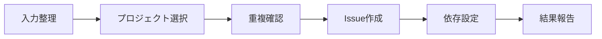

# Linear

会話・ドキュメント・URL・要件メモなど任意の情報源から Linear Issue を作成する。Issue に取りかかるときは、その Issue を In Progress にする（[Start](#start)）。操作には Linear MCP の `list_projects` `list_issues` `get_issue` `save_issue` を使う。

## Defaults

ユーザーが明示した値はデフォルトより優先する。指定がない項目には次の値を使い、assignee・dueDate・labels は設定しない。

| Field | Default |
| :-- | :-- |
| team | `marutto-ops` |
| project | [FDE] イニシアチブ配下で自身がメンバーのプロジェクトのうち、内容に合うもの（[Project](#project)） |
| status | `Todo` |
| priority | medium（ `3` ） |

priority の数値対応は `urgent=1` `high=2` `medium=3` `low=4` とする。

## Workflow

Issue 作成は入力整理、プロジェクト選択、重複確認、作成、依存設定、結果報告の順で進める。



### Input

1 Issue ごとに title と description を確定する。title は簡潔で検索しやすくし、description は [reference.md](reference.md) のテンプレートで背景、スコープ、完了条件を書く。マイルストーンやチェックリストを分割するときは 1 項目を 1 Issue とする。同じテーマの `[親]` Issue があれば `list_issues` で特定して `parentId` に設定する。

### Project

[FDE] イニシアチブ配下で自身がメンバーのプロジェクトを一覧し、Completed と Canceled を除いた中から Issue の内容に最も合うものを選ぶ。合うものがない、または 1 つに絞れないときは、作成せずにユーザーへ確認する。

```text
list_projects({ initiative: "[FDE]", member: "me", fields: ["name", "status", "summary"] })
```

### Duplicate Check

同じタイトルや内容の Issue がないか `list_issues` で検索する。見つかったときは新規作成せず、既存 Issue を報告する。

### Creation

`save_issue` に次の形で渡す。

```yaml
title: "<title>"
team: marutto-ops
project: "<選んだプロジェクト>"
state: Todo
priority: 3
description: |
  <テンプレートに沿った本文>
```

### Relations

後続 Issue があるときは、前提となる Issue を `blockedBy` に、関連するだけの Issue を `relatedTo` に設定する。

### Report

作成後、[reference.md](reference.md) の報告形式で title・Linear URL・project・status を返す。

## Start

セッションが Issue の作業に取りかかるときは、作業の最初に、確認なしで Issue を `In Progress` にする。それ以外の状態の変更はユーザーの指示があるときだけ行う。

1. `get_issue` で状態を読む
2. 状態の種類が `triage` ・ `backlog` ・ `unstarted` のときだけ、 `save_issue({ id: "<Issue の ID>", state: "In Progress" })` を呼ぶ。 `started` （In Progress・In Review・In Customer）、 `completed` 、 `canceled` の Issue は変えない
